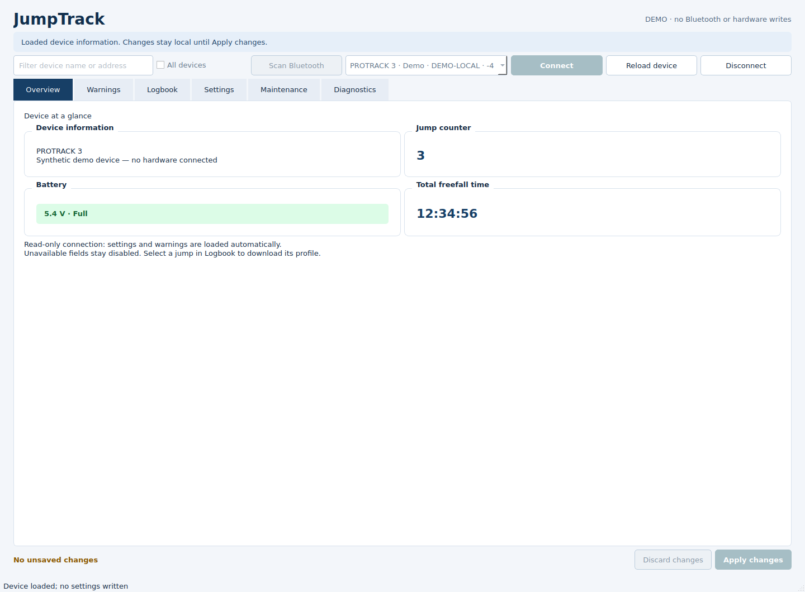
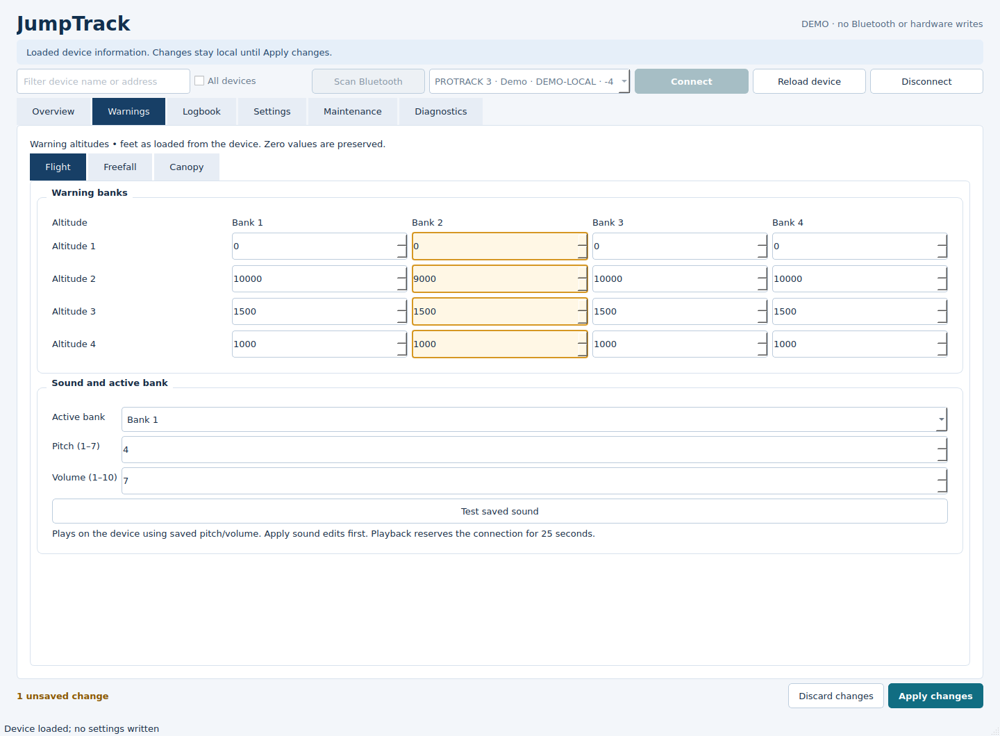
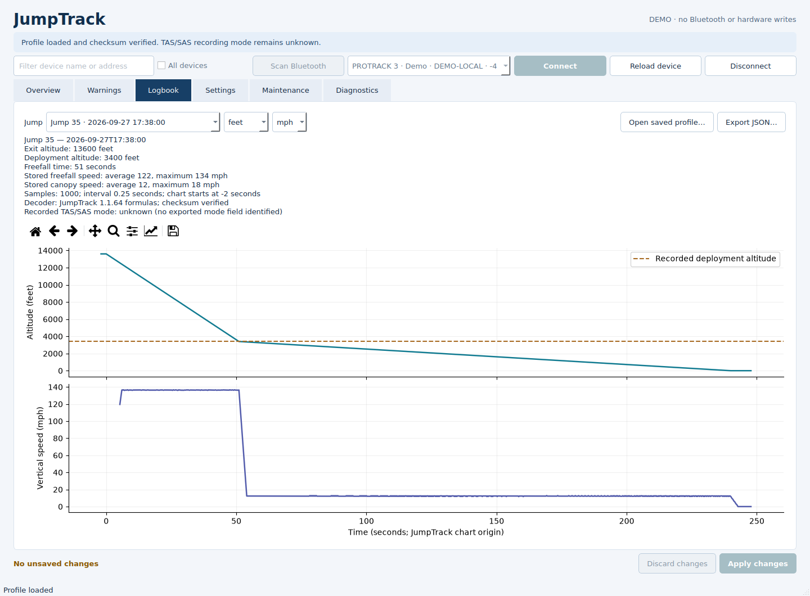
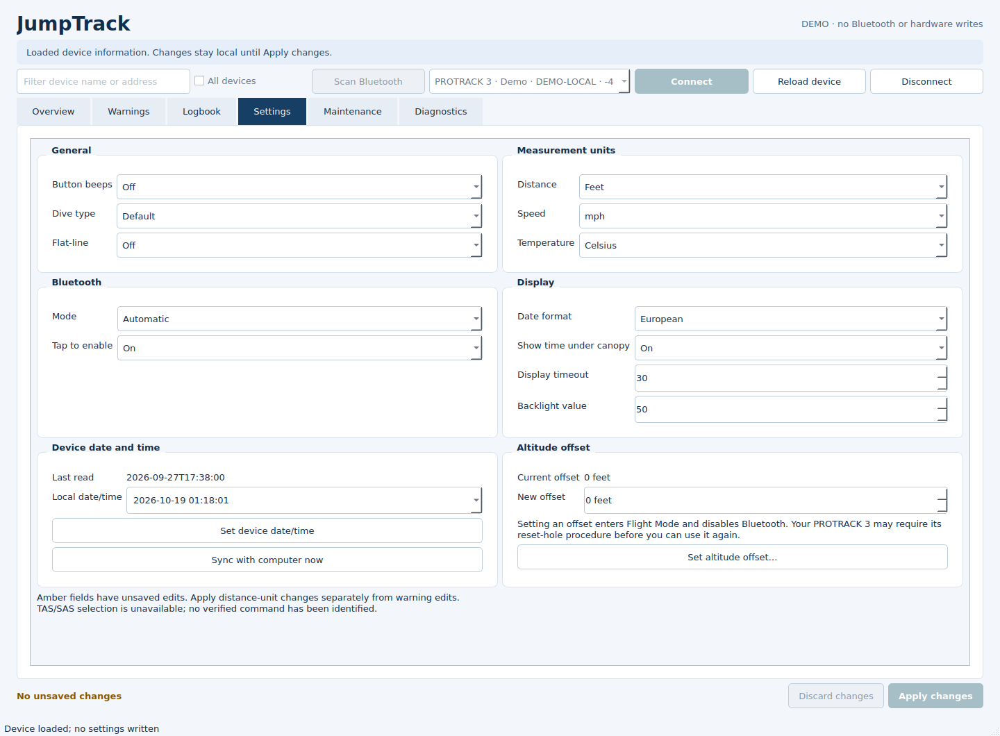
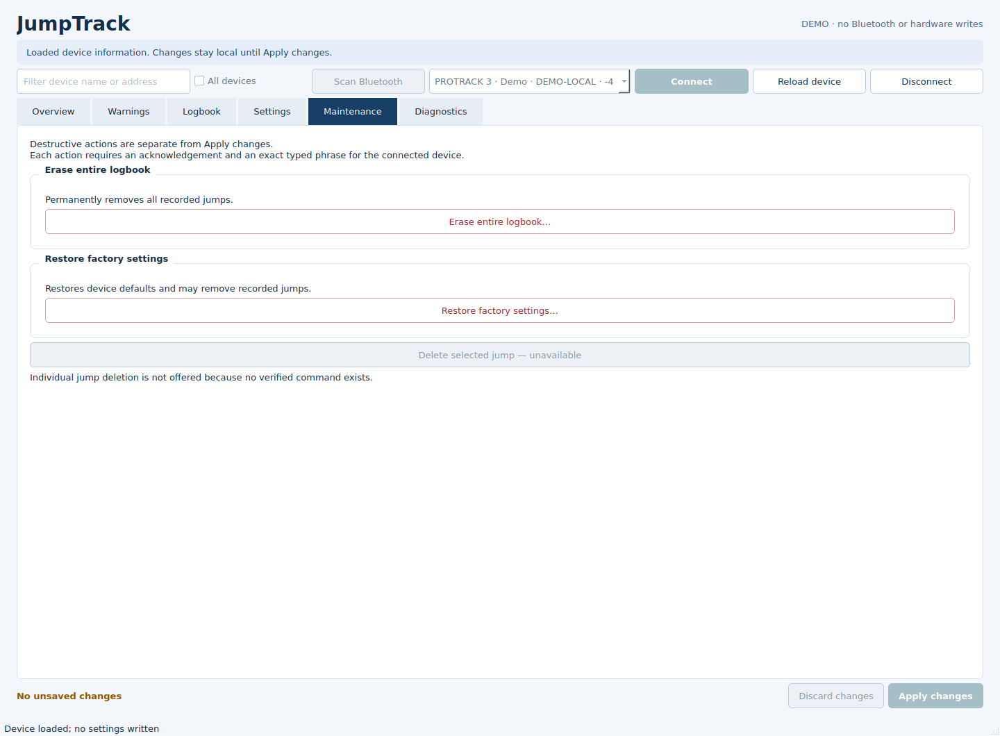
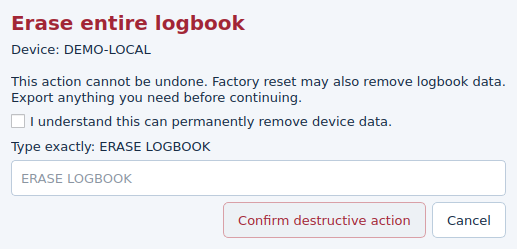

# JumpTrack Python

Unofficial BLE UART client based on an extracted Android `UARTCommandBuilder.java`.
It provides a desktop GUI, grouped CLI commands, a Python API, and app-derived
profile and ACC decoders and plotters.
PROTRACK 3 is the tested model; support for other device families is unverified.

## Setup

```bash
python3 -m venv .venv
.venv/bin/python -m pip install -r requirements.txt
export JUMPTRACK_ADDRESS="YOUR_DEVICE_ADDRESS"
jt() { .venv/bin/python jumptrack.py "$@"; }
jt --help
jt tree
```

Alternatively, use `--address` or put your identifier in the ignored local
`.jumptrack-address` file. Enable Bluetooth on the device immediately before a
live request. Constants, help, the command tree and dry runs need no connection.

## Desktop GUI

### Public downloads — v0.1.2 pre-release

No GitHub account or Python installation is needed to download these packages.

| Computer | Download |
| --- | --- |
| Windows x64 | [Installer (.exe)](https://github.com/emoninet2/lb-jumptrack/releases/download/v0.1.2/JumpTrack-0.1.2-windows-x86_64-Setup.exe) |
| Mac — Apple Silicon (M-series) | [Disk image (.dmg)](https://github.com/emoninet2/lb-jumptrack/releases/download/v0.1.2/JumpTrack-0.1.2-macos-arm64.dmg) |
| Mac — Intel | [Disk image (.dmg)](https://github.com/emoninet2/lb-jumptrack/releases/download/v0.1.2/JumpTrack-0.1.2-macos-x86_64.dmg) |
| Linux x64 | [AppImage](https://github.com/emoninet2/lb-jumptrack/releases/download/v0.1.2/JumpTrack-0.1.2-linux-x86_64.AppImage) |
| Linux ARM64 | [AppImage](https://github.com/emoninet2/lb-jumptrack/releases/download/v0.1.2/JumpTrack-0.1.2-linux-arm64.AppImage) |

See the [release page](https://github.com/emoninet2/lb-jumptrack/releases/tag/v0.1.2)
for portable alternatives, checksums and testing limitations, or [all releases](https://github.com/emoninet2/lb-jumptrack/releases).
These are unsigned development packages; macOS builds are not notarized.

For a computer without Python, the shared desktop build pipeline produces a
Windows installer/portable ZIP, macOS DMG/app ZIP (Intel and Apple Silicon), and
Linux AppImage/TAR.GZ (x64 and ARM64). See [installation instructions](docs/INSTALLING.md)
for choosing and opening a package. These are unsigned development packages;
Windows/macOS Bluetooth behavior still needs real-machine validation.

The **Desktop packages** GitHub Actions workflow builds and smoke-tests all five
targets from the same source after changes. Version tags publish a public
pre-release only after every build and package verification succeeds. Ordinary
branch/PR runs keep their downloads as temporary Actions artifacts. Maintainers can
build locally with `python build_desktop.py --native`. See
[packaging and release maintenance](docs/PACKAGING.md).

To run directly from source:

```bash
.venv/bin/python -m pip install -r requirements-gui.txt
.venv/bin/python jumptrack_gui.py
# Synthetic preview without Bluetooth or hardware writes:
.venv/bin/python jumptrack_gui.py --demo
```

Scan and select a Bluetooth device, then connect to load available information,
warnings, settings and the jump list. Edits are staged locally and highlighted;
**Apply changes** writes only affected operations and reads back to verify them.
The Logbook tab provides a jump selector, information panel, altitude/vertical-speed
graphs, local file opening and JSON export. Unavailable settings remain disabled.

Erase-logbook and factory-reset actions are separate and require both an
acknowledgement and an exact typed phrase. Individual jump deletion is disabled
because no verified command is available. See [desktop workflow and safeguards](docs/GUI.md).
The screenshots and automated GUI tests use synthetic data. CLI dependencies
remain separate from optional GUI dependencies.

### Desktop tour

These are screenshots of the running **demo app**, not live device captures.
Names, jump records, battery readings and profiles are synthetic. Demo mode
exercises the interface without Bluetooth or hardware writes; device firmware
may omit some of the settings shown here.

**Overview and connection.** Scan by name/address, choose a device, and connect
to load its information. The overview shows the jump counter, accumulated
freefall time, and battery voltage with the device-reported status. Full, Half,
Almost empty and Critical use green, yellow, orange and red respectively;
unknown status is grey. These levels are not percentage estimates. The session
stays open across ordinary edits and applies until Disconnect or closing the app,
unless the hardware drops its connection.



**Warning banks and sound tests.** Flight, Freefall and Canopy have separate
tabs, with banks as columns and altitude thresholds as rows. The amber bank
below contains a local edit; **Apply changes** writes affected settings and reads
them back. **Discard changes** restores the loaded values without writing.
Active bank, pitch and volume are configured below the table. **Test saved sound**
plays the category's saved sound on the device and reserves the connection for
the APK's 25-second playback window. Apply pitch/volume edits before testing;
sound settings are shared across banks within each category.



**Logbook and graphs.** Select a jump to load its checked profile, recorded
exit/deployment altitudes, freefall time and stored speed statistics. The charts
show altitude and derived vertical speed over time; the dashed line marks the
recorded deployment altitude. Display units, pan/zoom, saved-profile opening and
JSON export are available here. TAS/SAS recording mode remains unknown rather
than inferred from the graph.



**Settings, date/time and altitude offset.** Preferences are grouped into
General, Measurement units, Bluetooth and Display. Separate clock controls set
a local date/time or sync with the computer, with readback verification.
Altitude offset shows the current signed value in the device's distance units.
It requires its own acknowledgement and typed `SET OFFSET` confirmation:
setting an offset enters Flight Mode and disables Bluetooth, and the tested
PROTRACK 3 may need its reset-hole procedure before further use. Offset is sent
once and ends the session; the app does not claim an immediate verified readback.



<details>
<summary>Maintenance and deletion safeguards</summary>

Erasing the logbook and restoring factory settings are separated from ordinary
editing. Each dialog identifies the device and requires both acknowledgement and
an exact action-specific phrase. Cancel is the default and confirmation starts
disabled. Single-jump deletion remains disabled because no verified command is
available. These screenshots only show the controls; no erase/reset was run.





</details>

## CLI

Commands are grouped by purpose. Run `--help` at any level for arguments and
choices. Entering a group alone shows its help. See the [full tree](docs/CLI_TREE.md).

| Group | Purpose | Example |
| --- | --- | --- |
| `device` | Information, recognized models and power | `jt device info` |
| `logbook` | Jump list, profiles, ACC and accumulated totals | `jt logbook profile 35` |
| `settings` | Device preferences and units | `jt settings beeps off` |
| `alarms` | Warning banks, sounds, motion and guides | `jt alarms sound canopy play` |
| `maintenance` | Logbook erasure and factory reset | `jt --allow-destructive maintenance erase-logbook` |
| `advanced` | Java methods, constants and complete settings records | `jt advanced raw-settings get 40` |
| `tree` | Offline command hierarchy | `jt tree` |

Put shared options **before** the first command:

| Option | Purpose |
| --- | --- |
| `--address IDENTIFIER` | Override the configured BLE identifier. |
| `--debug` | Print incoming BLE packets as hex. |
| `--dry-run` | Preview a device operation without connecting or writing files. |
| `--output FILE` | Save the operation's displayed result; overwrite an existing file. |
| `--allow-destructive` | Permit erase, factory reset or jump-counter replacement. |

```bash
jt --address YOUR_DEVICE_ADDRESS device info
jt --output jumptrack_data/profile.txt logbook profile 35 --timeout 120
jt --dry-run alarms sound canopy set 3 6
jt device list-models
```

Without a command, the legacy default reads device information, jump counter and
jump list and saves them under `jumptrack_data/` in the current directory.

### Bluetooth discovery

```bash
jt device scan                         # Recognized JumpTrack families only
jt device scan --filter protrack        # Name or address substring, case-insensitive
jt device scan --all                    # Include other devices and unnamed advertisements
jt device scan --all --filter AA:BB     # Narrow by address
jt device scan --timeout 20             # Default 10 seconds; allowed 1–300
jt device scan --json                   # Structured results
jt --output devices.json device scan --json
```

Scanning needs no configured address and does not connect, pair or change device
settings. It lists advertised names, platform identifiers, signal strength in
dBm, recognized family and whether the exact model is in the tested-model list.
Results are sorted by signal strength, strongest first. A recognized name is a
hint, not proof of compatibility or device identity. Advertisement names can be
missing until the device enables Bluetooth; use `--all` when troubleshooting.
`--filter` narrows the default family selection; add `--all` to search other devices.
Addresses are not saved automatically. Copy the desired identifier into `--address`,
`JUMPTRACK_ADDRESS`, or `.jumptrack-address` for subsequent operations.

### Logbook

```bash
jt logbook list
jt logbook profile 35
jt logbook acc 35 0 60 --format hex --timeout 120
jt logbook totals jumps get
jt --allow-destructive logbook totals jumps set 35
jt logbook totals freefall-time set 12 34 56
```

Profile and ACC response timeouts default to 90 seconds; overrides accept
1–3600 seconds. Jump numbers, ACC fields and total freefall-time fields accept
signed Java integers. Exact firmware limits remain unverified; hex ACC scaling
and timing now follow the recovered app source. The freefall-time command replaces the accumulated total.

### Decoded profiles and deployment altitude

The profile header already includes the recorded deployment altitude. Request a
readable summary, including exit/deployment altitude, freefall time and stored speed stats:

```bash
jt logbook profile 33 --format summary
jt logbook profile 33 --format summary --units meters --speed-unit kmh
jt logbook profile 33 --format text      # Summary plus altitude/speed samples
jt logbook profile 33 --format csv       # Samples for spreadsheets
jt --output jumptrack_data/jump33.json logbook profile 33 --format json
# Decode an existing download without Bluetooth:
jt logbook profile 33 --file jumptrack_data/jump_00033_profile.txt --format summary
```

The default `--format hex` retains the existing raw download behavior. Decoded
altitude units are `feet` (default) or `meters`; speed units are `mph` (default),
`kmh`, `fps`, or `mps`. JSON includes named raw header values, selected-unit
summaries, count warnings and all samples. CSV leaves unavailable speed cells
blank; JSON uses null. Live JSON/CSV transport progress goes to stderr.

Decoding follows the recovered JumpTrack 1.1.64 formulas: header ground pressure,
0.1 hPa/count pressure samples, 0.25-second intervals starting at -2 seconds on
the app's chart axis, and speed from 3/6-second altitude windows. The first
29 samples have no speed value. Deployment altitude is the recorded header
field, not an inferred point on the curve. The summary labels speeds neutrally:
the APK names these fields `Tas`, but that does not confirm the recording mode.
Header speed summaries are distinct
from derived vertical-speed samples and the device's TAS/SAS display preference.
Profile CRC and byte-count metadata are verified. Independent physical/hardware
accuracy remains unverified. See
[profile format](docs/PROFILE_FORMAT.md) and [APK audit](docs/APK_AUDIT.md).

### Acceleration (ACC)

```bash
jt logbook acc 33 0 60 --decode summary
jt logbook acc 33 0 60 --decode json
jt --output acc.csv logbook acc 33 0 60 --decode csv
jt logbook acc 33 0 60 --file jumptrack_data/acc33.txt --decode text
python plot_acc.py --file jumptrack_data/acc33.txt
python plot_acc.py --jump 33 --start 0 --duration 60
```

`--format hex` remains the default wire request. `--decode` adds app-derived
scalar acceleration, timestamps and verified integrity. Words are divided by
256 for g; `FFFF` maps to zero while retaining a sentinel flag and raw value.
The interval is 0.02 seconds, starting at the requested start time. Text-wire
ACC can still be retrieved with `--format text`, but its layout is unverified
and cannot be combined with `--decode` or `--file`. Empty responses stay empty;
no samples or chart are fabricated. ACC is scalar, not an XYZ vector or a
replacement for barometric altitude/speed. See [ACC and integrity](docs/ACC_AND_INTEGRITY.md).

### Settings

```bash
jt settings show
jt settings beeps off
jt settings dive-type
jt settings dive-type slow
jt settings units distance feet
jt settings units speed kmh
jt settings units show-speed
jt settings units temperature celsius
jt settings datetime now
jt settings datetime 2026-10-18T14:30:00
jt settings altitude 500 --negative
jt settings bluetooth mode economy
jt settings bluetooth tap-to-enable on
jt settings display backlight on --value 50
jt settings display date-format eu
jt settings display show-time-under-canopy on
jt settings display timeout 30
jt settings flatline-cutoff 500
```

`settings show` labels known fields and retains raw responses. Unknown values
remain explicitly unknown. A missing W-42 record is reported rather than filled
with invented values. `settings dive-type` reads the current dive type; supplying
a value changes it:

| Code | Java-derived enum | CLI value |
| --- | --- | --- |
| 0 | `DEFAULT` | `default` |
| 1 | `_3_SECONDS` | `3_seconds` |
| 2 | `SLOW` | `slow` |
| 3 | `SUPER_SLOW` | `super_slow` |

“None” has not been verified as a device-display alias of `DEFAULT`.

Individual controls in settings groups 40–42 read the current record, preserve
other fields, skip unchanged values, write once and read back for verification.
Malformed, incomplete, ambiguous or unknown records prevent a write. Operations
using the same client serialize these updates and complete-group writes. These
write sequences are tested with mocks; live configuration writes remain unverified.
Dry runs show the planned sequence because current fields require a live read.

Datetime accepts local wall-clock values without a timezone offset. Altitude
accepts magnitude 0–65000; `--negative` selects the negative sign. Units and
firmware limits for display timeout/backlight values are not established by the
builder. Individual numeric settings accept nonnegative signed Java integers;
the advanced complete-group interface preserves the broader Java input domain.

TAS/SAS is currently unsupported. Comparing TAS and SAS reads across `R-00`–`R-99`
found no mode-dependent field. This does not prove the hardware cannot expose it.
See [hardware observations](docs/PROTOCOL_OBSERVATIONS.md).

### Alarms and maintenance

```bash
jt alarms show
jt alarms warnings freefall set 4500 3500 2500 --bank 1
jt alarms warnings canopy select-bank 2
jt alarms warnings flight set 1000 2000 3000
jt alarms sound canopy set 4 7
jt alarms sound canopy play
jt alarms motion 10 5
jt alarms canopy-guide on
# Read guide status together with warning banks:
jt alarms show
# Original alias:
jt alarms swoop-guide on
jt alarms track-guide off
jt alarms restore-defaults
jt device power-off
jt --allow-destructive maintenance erase-logbook
jt --allow-destructive maintenance factory-reset
```

Warning banks are 1–4. Freefall/canopy warning writes require `--bank`; flight can
omit it for the legacy W-01 command. Exactly four warning values produce four
fields; other valid lengths of at least three produce a leading zero and the
first three values. Numeric-list validation rejects signed strings. Threshold
units and the meaning of zero are not inferred. Pitch is 1–7 and volume is 1–10.

Both guide commands produce the same W-21 write, matching the Java reference.
Motion countdown/sensitivity and backlight firmware limits remain unverified.
Power-off submits its write without waiting for EOF, as confirmed by a user test.
Other successful write responses do not by themselves confirm device behavior.
Commands are not retried automatically. After a write timeout, inspect the device
or read its settings before deciding whether to retry.

### Advanced commands and compatibility

```bash
jt advanced constants
jt --dry-run advanced java prepareSetDistanceUOM '["METERS"]'
jt --dry-run advanced java prepareSendFlightWarningsCommand '[2,["1000","2000","3000","4000"]]'
jt advanced raw-settings get 40
jt advanced raw-settings set 40 --ble-mode automatic --beeps off --dive-type default --temperature-unit celsius
jt advanced raw-settings set 41 --tap-to-enable-ble on --flatline-cutoff 0
jt advanced raw-settings set 42 --backlight-value 50 --date-format eu --show-time-under-canopy on --lcd-timeout 30
```

Complete-group writes require all named fields and replace the entire record.
W-41 reserved fields are set to zero. These advanced writes do not automatically
preserve or verify current settings. Use individual controls for that behavior.
Java enum arguments use exact member names; arguments are a JSON array. Both
freefall-time and flight-warning overloads are supported. See the
[Java parity reference](docs/JAVA_MASTER_PARITY.md) for all signatures and rules.

Original flat commands and operation flags remain accepted for existing scripts
but are hidden from the main help/tree. Examples: `jt beeps off`, `jt profile 35`,
`jt --settings`, `jt --warnings`, `jt --profile 35`, `jt --list-devices`.
Do not mix a grouped/flat command with legacy operation flags. Legacy reads
write raw results and warning summaries to `jumptrack_data/`; matching filenames
are overwritten. Grouped commands print their result and save it only with
`--output`. Legacy batch reads report response timeouts and continue.

## Profile plotting

```bash
# Default: raw values, decoded altitude and derived vertical speed.
.venv/bin/python plot_profile.py --file jumptrack_data/jump_00033_profile.txt
.venv/bin/python plot_profile.py --file jumptrack_data/jump_00033_profile.txt --units meters --speed-unit kmh
# Live read; no configuration writes.
.venv/bin/python plot_profile.py --jump 33
# Raw-only view, or retain the older explicit experimental model.
.venv/bin/python plot_profile.py --file jumptrack_data/jump_00033_profile.txt --raw
.venv/bin/python plot_profile.py --file jumptrack_data/jump_00033_profile.txt --pressure-scale 0.1 --reference-pressure 1007 --units feet
```

The default plot uses app-derived decoding and marks the recorded deployment
altitude. It exports PNG, CSV, raw response and metadata JSON under
`jumptrack_data/profile_plots/`. Unit-specific filenames separate decoded outputs
from raw and legacy experimental results. Matching outputs are overwritten;
the input file is preserved. Use `--show` for a GUI window or `--output-dir` to
choose a destination. `--sample-interval` overrides only raw/experimental plots;
app decoding always uses its source-defined timing.

`--strict-count` rejects structural count mismatches; `--expected-count` compares
the header against a jump-list count. CRC and byte-count verification is a
separate, mandatory check for decoded profiles and ACC.
See [profile format](docs/PROFILE_FORMAT.md) and [count evidence](docs/PROFILE_COUNT_COMPARISON.md).

## Python API and verification

```python
from uart_command_builder import UARTCommandBuilder
from jumptrack import JumpTrack

print(UARTCommandBuilder().set_sound("canopy", 3, 6))
# Inside an async function:
# device = JumpTrack(address="...", allow_writes=True)
# try:
#     await device.connect()
#     print(await device.set_setting_field(40, 2, 2))
# finally:
#     await device.disconnect()
```

The builder exposes all 40 saved Java signatures (38 unique names), constants,
enum mappings, validation and null behavior. CamelCase client methods and
`execute_java()` expose the corresponding transports. Friendly adapters delegate
to the same builder. Java minimum formatting widths do not imply firmware bounds.

```bash
.venv/bin/python -m unittest discover -s tests -t . -v
```

Tests mock Bluetooth and cover routing, permissions, settings preservation,
verification, transport framing, timeouts and experimental profile parsing.
Tests that hash or execute the private Java reference skip when it is absent;
execution also requires `javac` and `java`. Saved signatures allow ordinary
coverage to run without that source. The recovered 1.1.64 reference was also
executed against all 663 cases successfully; see [APK audit](docs/APK_AUDIT.md).
Skipped tests on other checkouts are not current execution evidence.

## Project files

| File | Purpose |
| --- | --- |
| `jumptrack.py` | BLE transport, response interpretation and CLI entry point |
| `jumptrack_gui.py` | Desktop GUI and background asyncio bridge |
| `gui_backend.py` / `gui_demo.py` | Staged settings session and explicit synthetic demo |
| `app_metadata.py` / `desktop_entry.py` | Shared app identity and packaged startup/logging |
| `build_desktop.py` / `packaging/` | Shared desktop bundler, native installers and icon source |
| `.github/workflows/desktop.yml` | Windows, macOS and Linux builds with packaged smoke tests |
| `jumptrack_cli.py` | Command definitions, grouping, routing and previews |
| `java_uart_command_builder.py` | Java-derived commands and JSON adapters |
| `uart_command_builder.py` | Compatible Python-friendly builder aliases |
| `wire_protocol.py` | Shared CRC/byte-count validation |
| `acc_decoder.py` / `plot_acc.py` | App-derived ACC data and standalone charts |
| `profile_decoder.py` | Profile parsing, named headers, app-derived altitude/speed and text/JSON/CSV output |
| `plot_profile.py` | Profile charts and optional legacy experimental conversion |
| `tests/` | Offline regression tests and saved Java signatures |
| `docs/` | Command tree, protocol observations and technical references |
| `jumptrack_data/` | Ignored local captures, plots and investigation scripts |

## Reference source and licensing status

This project is unofficial and is not affiliated with or endorsed by LB Altimeters.
The extracted `UARTCommandBuilder.java` is a private, optional reference and is not
distributed. A local ignored copy was recovered from the user-supplied 1.1.64 XAPK; public
signatures and ordinary tests are included. See [APK audit](docs/APK_AUDIT.md). The builder contains no response decoder, checksum verification or
Bluetooth transport; those parts of this project are separate implementations.

No open-source license is granted by this repository at present. Redistribution
and relicensing rights for translated material have not been established; do not
assume the Python translation is MIT-licensed. Excluding the Java reference does
not itself resolve those rights.

Canopy guide is also available under **Warnings → Canopy** in the desktop app. Changes are staged until Apply changes and verified using W-21 readback. Devices that do not report a valid guide status leave this control unavailable.

Flatline cutoff is a numeric altitude reported by R-41. Hardware tests confirmed that writes of 0 and 1 take effect, while 500, 600 and 800 are echoed without changing the setting. Nonzero cutoff changes are therefore blocked in normal backend/CLI/GUI operations.

Read it with `jt settings flatline-cutoff`. To remove the altitude cutoff, use `jt settings flatline-cutoff 0`. Zero keeps the final flatline alarm active below the fourth warning subject to descent-speed conditions; it does not disable the alarm. In **Warnings → Freefall**, the altitude is read-only and **Clear cutoff (set 0)** stages zero until **Apply changes**. Bluetooth tap changes preserve the existing numeric cutoff. Set nonzero altitudes manually on the device.

The original Java boolean builder remains available only through the advanced compatibility interface.
